# Introducción

Colombia es un país de emisiones intermedias: aporta alrededor del 0,2 % del CO₂ mundial, pero su economía depende de hidrocarburos y carbón, y su territorio alberga una de las mayores superficies de bosque tropical del planeta. Esa combinación produce una estructura de emisiones atípica. El sector energético explica cerca del 38 % de los gases de efecto invernadero (GEI), mientras que el uso del suelo, la agricultura y los residuos completan el resto (IDEAM et al., 2026). Al mismo tiempo, la matriz eléctrica es una de las más limpias de América Latina: la hidroeléctrica aporta entre el 60 % y el 80 % de la generación según el año hidrológico, y las fuentes no convencionales de energía renovable (FNCER) —solar, eólica y biomasa— apenas comienzan a crecer.

En 2021 el Congreso aprobó la Ley 2169, conocida como Ley de Acción Climática, que fijó metas mínimas de mitigación: reducir el 51 % de las emisiones de GEI a 2030 respecto del escenario de referencia de la Contribución Determinada a Nivel Nacional (NDC), alcanzar la carbono neutralidad a 2050, reducir el carbono negro un 40 % frente a 2014 y llevar la deforestación neta a cero en 2030 (Congreso de la República de Colombia, 2021). El techo implícito para 2030 es de 169,44 Mt CO₂e, calculado sobre un escenario de referencia de 345,8 Mt CO₂e (MinAmbiente, 2020). La NDC 3.0 de 2025 ratificó ese techo y añadió metas a 2035 (República de Colombia, 2025).

La pregunta que motiva este trabajo es sencilla de formular y difícil de responder: **¿puede Colombia reducir sus niveles de CO₂ para 2030 y qué papel juegan las FNCER en esa reducción?** La dificultad no es retórica. Responderla exige, por un lado, medir emisiones que se distribuyen de forma extremadamente desigual en el territorio y que se observan mediante fuentes heterogéneas —inventarios nacionales, rejillas globales, registros satelitales y catastros de proyectos— y, por otro, separar el efecto de una política del crecimiento económico, la hidrología y la expansión demográfica.

Este artículo aborda esa pregunta integrando cuatro marcos metodológicos que normalmente se enseñan y se aplican por separado, pero que aquí comparten el mismo objeto de estudio y se necesitan mutuamente:

1. **Muestreo estadístico.** El territorio se trata como una población finita de celdas y se compara el error de estimación del total nacional bajo distintos diseños probabilísticos, incluido el muestreo espacialmente balanceado. Sin un diseño muestral explícito, cualquier mapa de emisiones es una colección de datos sin garantía de representatividad.
2. **Estadística espacial.** Las emisiones son un fenómeno espacialmente autocorrelacionado. Se cuantifica esa dependencia con índices globales y locales, se modela con el semivariograma y se evalúa si la interpolación geoestadística supera a los métodos deterministas de distancia inversa.
3. **Diseño de experimentos.** Para atribuir cambios de emisiones a tecnologías específicas se construye un experimento factorial en el que los tratamientos son las fuentes energéticas y las unidades experimentales son corridas de un modelo de despacho calibrado con datos observados. Esto permite separar el efecto de la tecnología del de la penetración y detectar la interacción entre ambos.
4. **Aprendizaje automático.** Los modelos predictivos identifican los determinantes de la densidad de emisiones a escala de celda y proyectan la trayectoria nacional hasta 2030 bajo escenarios explícitos, con validación espacial y de origen móvil.

La contribución del trabajo es triple. Primero, metodológica: muestra cómo se articulan los cuatro marcos sobre una misma base de datos geoespacial y cómo cada uno responde una pregunta distinta —cuánto, dónde, qué tecnología y qué pasará— sin sustituir a los demás. Segundo, empírica: ofrece una cuantificación del potencial de reducción de las FNCER que es consistente con la estructura de la matriz eléctrica colombiana y que identifica un límite estructural poco discutido en la literatura nacional. Tercero, de política: traduce los resultados en una evaluación explícita del cumplimiento de la Ley 2169, distinguiendo lo que la política energética puede lograr de lo que depende de otros sectores.

El resto del documento se organiza así. La sección 2 resume el marco normativo y los antecedentes. La sección 3 describe los datos y el área de estudio. La sección 4 presenta los métodos de cada módulo y su integración. La sección 5 reporta los resultados. La sección 6 discute implicaciones y limitaciones, y la sección 7 concluye.

# Marco normativo y antecedentes

## La Ley 2169 de 2021 y el techo de 2030

La Ley 2169 de 2021 establece en su artículo 5 las metas mínimas de mitigación: reducir el 51 % de las emisiones de GEI frente al escenario de referencia de 2030, alcanzar la carbono neutralidad a 2050, adoptar presupuestos de carbono para el período 2020-2030, reducir el carbono negro y llevar la deforestación neta a cero. La meta del 51 % se calcula sobre el escenario de referencia de la NDC de 2020, estimado en 345,8 Mt CO₂e, lo que arroja un techo de 169,44 Mt CO₂e para 2030 (MinAmbiente, 2020). Es importante subrayar que la meta es sobre **GEI totales**, no sobre CO₂ de origen energético, y que incluye las absorciones por uso del suelo.

El inventario nacional más reciente reporta emisiones netas de 276,7 Mt CO₂e para 2024, con el sector Energía aportando 105,3 Mt (38,1 %), seguido por uso del suelo (27,4 %), agricultura (21,0 %), residuos (9,4 %) e IPPU (4,2 %) (IDEAM et al., 2026). La distancia entre el nivel observado y el techo legal es, por tanto, de más de 100 Mt CO₂e en seis años.

## Transición energética en Colombia

La expansión de FNCER en Colombia ha sido lenta pero sostenida. La Estrategia 6GW fijó como meta agregar 6 GW de capacidad renovable no convencional a 2026 partiendo de una base de 297 MW (UPME, 2025). A comienzos de 2026 el país reportaba 3.677 MW en operación y pruebas, equivalentes al 15,6 % de la capacidad instalada, aunque la generación solar y eólica efectiva seguía siendo una fracción menor del total (MinMinas, 2026; XM, 2026). La brecha entre capacidad y energía generada —y entre anuncios y operación comercial— es uno de los rasgos que este trabajo intenta reflejar.

La literatura colombiana sobre el nexo energía-emisiones se ha concentrado en tres frentes: la estimación del potencial técnico y económico de las renovables (Gaona et al., 2015; Henao et al., 2020), la evaluación de la política de transición y sus barreras institucionales (Arango-Aramburo et al., 2019; Botero et al., 2020) y la cuantificación de emisiones evitadas mediante factores de emisión promedio (UPME, 2023). Menos frecuente es el tratamiento simultáneo de la incertidumbre espacial y de la inferencia causal, que es justamente lo que aquí se aborda.

## Vacíos que este trabajo atiende

Tres vacíos justifican el diseño propuesto. Primero, la mayoría de las estimaciones de emisiones evitadas usan un factor de emisión promedio del sistema, lo que supone que cada MWh renovable desplaza una mezcla fija de tecnologías; en realidad el desplazamiento ocurre en el margen y depende de la composición fósil remanente. Segundo, los mapas de emisiones se presentan sin evaluar su incertidumbre muestral ni su estructura de dependencia espacial. Tercero, las proyecciones a 2030 suelen ser extrapolaciones de tendencia que no distinguen el efecto de la política del efecto del crecimiento. Los módulos de este trabajo atacan cada uno de esos vacíos.

# Datos y área de estudio

## Unidad espacial y marco muestral

La unidad de análisis espacial es la celda de 0,1° de latitud por 0,1° de longitud del Inventario de Emisiones EDGAR (Emissions Database for Global Atmospheric Research) del Centro Común de Investigación de la Comisión Europea, que reporta CO₂ por celda y año con cobertura global (Crippa et al., 2023). Se eligió esta resolución por tres razones: es el soporte nativo del dato, evita la falsa precisión de remuestreos a resoluciones menores, y produce un tamaño de población manejable para el análisis muestral y geoestadístico.

El marco se construyó recortando la rejilla global a los polígonos departamentales de GADM 4.1 y conservando las celdas con al menos 1 % de su superficie en territorio colombiano. El resultado son **9.657 celdas** que cubren 1.184.629 km² (frente a 1.137.740 km² de superficie terrestre oficial, por el desborde de las celdas de borde) y que suman 102,14 Mt CO₂ en 2023, el 102 % de la estimación nacional exacta de EDGAR para ese año (100,04 Mt); la diferencia corresponde a celdas transfronterizas. Las coordenadas se manejaron en MAGNA-SIRGAS / Origen Nacional (EPSG:9377), el sistema oficial de referencia para cartografía urbana y de detalle en Colombia, y las áreas se calcularon en esa proyección.

Las emisiones por celda se obtuvieron para 2015, 2023 y 2025. La Figura @fig-mapa-densidad muestra la distribución de la densidad de emisiones de 2023.

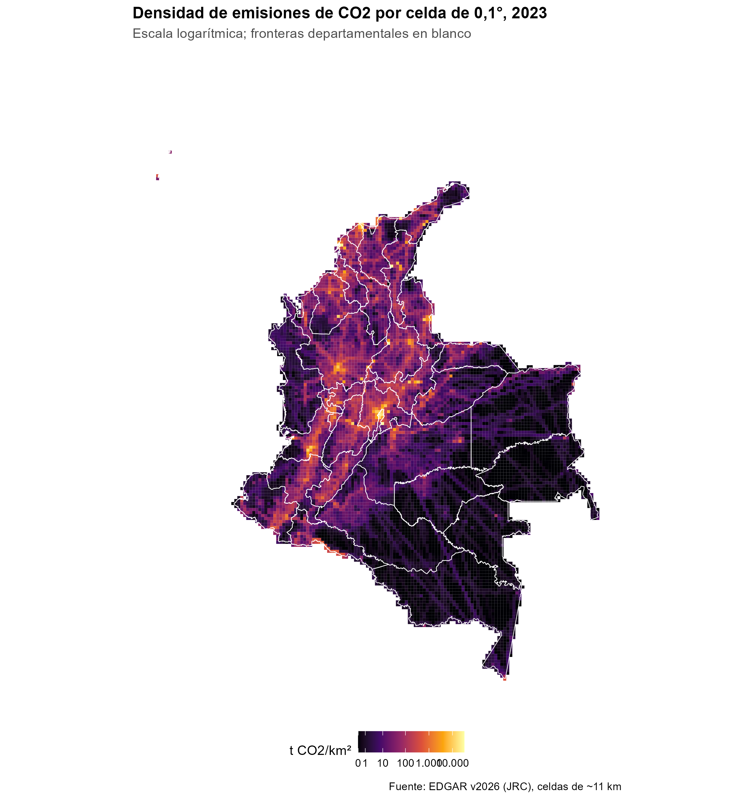{#fig-mapa-densidad width="78%"}

## Covariables

A la grilla se incorporaron covariables de tres tipos. La **población** proviene de WorldPop 2020 a 1 km, agregada a la celda y calibrada para que su suma coincida con la población nacional de OWID (50,63 millones), de modo que se preserva el patrón espacial urbano-rural y el nivel agregado oficial. Las **emisiones por sector** provienen de Climate TRACE v5.7, que reporta 18.979 activos individuales georreferenciados para Colombia en 2023 y que se agregaron a la celda por macro-sector (energía, transporte, edificaciones, industria, operaciones fósiles, uso del suelo y residuos). Los **proyectos FNCER** provienen del registro de metas FNCER del Ministerio de Minas y Energía: 158 proyectos solares y eólicos con capacidad, año de entrada y municipio, de los cuales 149 (94 %) se geolocalizaron por emparejamiento de nombres con los 1.119 municipios de GADM, quedando 69 municipios con al menos un proyecto operativo a 2023 y 4.515 MW declarados.

## Series nacionales

Para la dimensión temporal se construyó un panel anual 1990-2026 con las siguientes fuentes: emisiones de CO₂ y GEI totales del Global Carbon Budget vía Our World in Data (Friedlingstein et al., 2023); producto interno bruto en dólares constantes de 2015 del Banco Mundial, necesario porque la serie de OWID no reporta PIB para 2023-2024; población de OWID; generación eléctrica por fuente de la UPME (2000-2026, con 2026 parcial); capacidad, generación, emisiones e intensidad por fuente de Ember (2000-2025); y emisiones del inventario nacional por subsector del IDEAM (1990-2024). La Tabla @tbl-fuentes resume las fuentes y su uso.

| Fuente | Variable | Cobertura | Uso en el estudio |
|:-------|:---------|:----------|:------------------|
| EDGAR v2026 (JRC) | CO₂ por celda 0,1° | 2015, 2023, 2025 | Marco muestral, estadística espacial, ML de celdas |
| Climate TRACE v5.7 | CO₂ por activo | 2023 | Covariables sectoriales, triangulación, estimador de razón |
| GADM 4.1 | Departamentos y municipios | 2024 | Estratificación, regiones, unidad municipal |
| WorldPop 1 km | Población | 2015, 2020 | Covariable, estratificación auxiliar |
| MinEnergía | Proyectos FNCER | 2004-2025 | Tratamiento municipal, capacidad instalada |
| UPME | Generación por fuente | 2000-2026 | Experimento factorial, escenarios |
| Ember | Emisiones e intensidad por fuente | 2000-2025 | Factores de emisión, serie eléctrica |
| OWID / GCB | CO₂ y GEI nacionales | 1850-2024 | Serie histórica, pronóstico |
| Banco Mundial | PIB constante 2015 | 1960-2024 | Modelo de crecimiento |
| IDEAM / BTR2 | Inventario nacional de GEI | 1990-2024 | Contexto y contraste |

: Fuentes de datos y uso en el estudio. {#tbl-fuentes}

# Métodos

## Diseño general

El estudio se organiza en cuatro módulos que comparten la misma base geoespacial y temporal, y un quinto paso de integración. Cada módulo responde una pregunta distinta y utiliza una unidad de análisis distinta, lo que se resume en la Tabla @tbl-modulos.

| Módulo | Pregunta | Unidad | Método principal | Producto |
|:-------|:---------|:-------|:-----------------|:---------|
| Muestreo | ¿Cuánto CO₂ emite Colombia y con qué precisión se estima? | Celda de 0,1° (N = 9.657) | Diseños probabilísticos, Monte Carlo, estimadores HT y de razón | Total estimado con IC y comparación de diseños |
| Estadística espacial | ¿Dónde se concentra y cómo se autocorrelaciona? | Celda de 0,1° | Moran global y local, semivariograma, kriging vs IDW | Mapas de clústeres y de predicción con error |
| Diseño de experimentos | ¿Qué tecnología y cuánta penetración reducen más? | Corrida experimental (año × tecnología × penetración) | Factorial 5×3 con bloque, ANOVA, superficie de respuesta | Efectos por tecnología y umbral estructural |
| Aprendizaje automático | ¿Qué explica la densidad y qué pasará en 2030? | Celda (espacial) y año (nacional) | Random Forest, XGBoost, validación espacial y de origen móvil | Importancia de variables y pronóstico con escenarios |

: Articulación de los cuatro módulos metodológicos. {#tbl-modulos}

## Módulo 1: diseño y estimación muestral

### Estratificación con información auxiliar

La variable de interés es el total de emisiones de 2023, $T=\sum_{i=1}^{N} y_i$, con $N=9.657$. Un diseño real no puede estratificar usando la variable que quiere estimar, de modo que la estratificación se construyó con la cartografía de emisiones de 2015, disponible antes del operativo. Se definieron cinco estratos por quintiles de emisión de 2015; el estrato superior concentra la mayor parte del total y el inferior agrupa las celdas sin emisiones apreciables. Esta decisión es sustantiva: estratifica por magnitud esperada, no por localización, y es la que un operativo de campo podría replicar.

### Diseños comparados

Se compararon cinco diseños con tamaño de muestra $n$:

1. **Muestreo aleatorio simple (MAS)**, con igual probabilidad de inclusión.
2. **Estratificado con asignación proporcional**, $n_h = n\,N_h/N$.
3. **Estratificado con asignación de Neyman**, $n_h = n\,N_h S_h / \sum_h N_h S_h$, que minimiza la varianza del estimador para un costo fijo (Neyman, 1934).
4. **GRTS** (*Generalized Random Tessellation Stratified*), un muestreo espacialmente balanceado que ordena el marco mediante una teselación aleatoria jerárquica y selecciona unidades con probabilidad proporcional al orden, garantizando cobertura espacial (Stevens & Olsen, 2004); se implementó con el paquete `spsurvey`.
5. **GRTS con asignación de Neyman**, que combina el balance espacial con la asignación óptima dentro de cada estrato y constituye el diseño final del estudio.

### Estimadores

Para cada diseño se calcularon dos estimadores del total. El estimador de Horvitz-Thompson, $\hat{T}_{HT}=\sum_h N_h \bar{y}_h$, con varianza $\sum_h N_h^2(1-f_h)s_h^2/n_h$ (Horvitz & Thompson, 1952), y un estimador de razón que usa las emisiones de Climate TRACE de 2023 como variable auxiliar, $\hat{T}_{R}=X_{total}\,\sum_i w_i y_i / \sum_i w_i x_i$, con $w_i=1/\pi_i$. El segundo aprovecha que Climate TRACE y EDGAR miden el mismo fenómeno con errores parcialmente independientes.

### Simulación Monte Carlo

Se evaluó cada diseño con 400 réplicas para los diseños aleatorios y 50 para los de GRTS, por costo computacional, en tamaños $n \in \{100, 200, 400, 800\}$ para los primeros y $n=400$ para GRTS. Para cada réplica se calculó el sesgo relativo, el coeficiente de variación (CV), el error cuadrático medio relativo y la cobertura del intervalo de confianza del 95 %. El diseño final se aplicó una vez con semilla fija para producir la muestra de 400 celdas y su estimación con intervalo bootstrap de 1.000 réplicas.

## Módulo 2: estadística espacial

### Autocorrelación global y local

Se calculó el índice de Moran global (Moran, 1950) sobre el logaritmo de la densidad de emisiones, $\log(1+\text{t CO}_2/\text{km}^2)$, con tres matrices de pesos: vecindad de torre a 12 km (4 vecinos), vecindad de reina a 16 km (8 vecinos) y k vecinos más cercanos con $k=6$. La significancia se evaluó con 999 permutaciones. Se calculó también el índice para el CO₂ total y para la población, como contraste.

El análisis local usó los indicadores LISA (Anselin, 1995) con 999 permutaciones y prueba bilateral, clasificando las celdas en HH (alto-alto), LL (bajo-bajo), HL y LH según el signo del indicador y la posición respecto de la media. Se aplicó además una corrección de Benjamini-Hochberg para controlar la tasa de falsos descubrimientos, dado que se realizan 9.657 pruebas simultáneas.

### Semivariograma e interpolación

Se estimó el semivariograma empírico de la densidad logarítmica con un alcance de 280 km y se ajustaron modelos esférico, exponencial y gaussiano por mínimos cuadrados ponderados, seleccionando el de menor suma de errores cuadrados. A partir del modelo elegido se realizó kriging ordinario, que se comparó con la distancia inversa ponderada (IDW) con exponentes 1, 2 y 3.

La comparación se hizo con validación cruzada espacial por bloques (cinco bloques), que evita la fuga de información entre vecinos, un problema documentado en la literatura de validación espacial (Roberts et al., 2017). Se evaluó el efecto de la densidad de entrenamiento usando el 25 %, 50 % y 100 % de los puntos. Las diferencias de error cuadrático medio se contrastaron con la prueba de Diebold-Mariano con covarianza de largo plazo y con un bootstrap pareado de 2.000 réplicas.

## Módulo 3: diseño de experimentos con fuentes energéticas como tratamientos

### Factores, bloques y unidad experimental

El experimento tiene dos factores: **tecnología** (cinco niveles: solar, eólica, biomasa, hidro y fósil) y **penetración** (tres niveles: 5 %, 15 % y 30 % de la generación anual del año correspondiente). El bloque es el año, con 16 bloques (2010-2025), lo que controla la variabilidad hidrológica y de demanda. El diseño es un factorial completo 5×3 con 16 réplicas, es decir, 240 corridas, cuyo orden se aleatorizó con semilla fija. La unidad experimental es la corrida: una combinación de año, tecnología y penetración evaluada en un modelo de despacho.

### Modelo de despacho y respuesta

Para cada corrida se simula un contrafactual sobre la matriz observada del año: se añade una generación $\Delta G = p \times G_{total}$ con la tecnología del tratamiento y se desplaza generación fósil en orden de mérito —primero carbón, luego gas y por último líquidos— hasta agotar la disponibilidad. Si la penetración excede la generación fósil disponible, el excedente no desplaza nada (saturación). La respuesta es la diferencia entre las emisiones evitadas del fósil desplazado y las emisiones de la tecnología añadida:

$$
E_{evitado} = \sum_{f} \Delta G_f \cdot FE_f - \Delta G \cdot FE_{tec},
$$

donde los factores de emisión $FE$ son las intensidades implícitas de Ember por fuente (carbón 0,872; gas 0,642; líquidos 0,700; biomasa 0,216; solar, eólica e hidro con ciclo de vida cercano a 0,024 t CO₂e/MWh).

### Análisis estadístico

El modelo principal es un ANOVA de tres vías con bloque,

$$
y_{ijk} = \mu + \tau_i + \beta_j + (\tau\beta)_{ij} + \gamma_k + \varepsilon_{ijk},
$$

con $\tau$ tecnología, $\beta$ penetración y $\gamma$ el efecto de bloque (año), estimado por sumas de cuadrados tipo III. Se reportan los estadísticos $F$, los valores $p$ y el tamaño del efecto $\eta^2$ parcial. Se verificaron los supuestos con Shapiro-Wilk y la prueba de Levene. Dado que en un experimento computacional determinista los supuestos de Normalidad y homocedasticidad pueden violarse sin invalidar el diseño balanceado, se añadieron tres análisis de robustez: ANOVA sobre la respuesta transformada logarítmicamente, prueba de Kruskal-Wallis y ANOVA de Welch.

Para estimar el efecto marginal de la penetración se ajustó además un modelo con la penetración como covariable continua y su interacción con la tecnología.

### Superficie de respuesta para 2030

La segunda parte del experimento es un diseño central compuesto (Box & Wilson, 1951) con dos factores continuos —participación solar y participación eólica en la generación de 2030, entre 0 % y 40 % cada uno— y 13 corridas (cuatro factoriales, cuatro axiales y cinco puntos centrales). La respuesta es el CO₂ del sector eléctrico en 2030, calculado con un modelo contable que proyecta la demanda mediante una tendencia log-lineal sobre la generación de 2000-2025 (95.901 GWh en 2030) y aplica despacho por orden de mérito. A diferencia del factorial, aquí se reconoce que la nueva FNCER solo puede desplazar la fracción fósil: una vez agotada, el excedente se considera vertido y no produce reducción adicional. Esta restricción es la que define el límite estructural del potencial de mitigación.

## Módulo 4: aprendizaje automático

### Modelo espacial de densidad de emisiones

Se ajustaron tres modelos para predecir el logaritmo de la densidad de emisiones de 2023 en las 9.657 celdas a partir de población, densidad poblacional, región natural, distancia al municipio con FNCER más cercano, número de proyectos, capacidad instalada, área y coordenadas: Random Forest (Breiman, 2001) con 600 árboles y `ranger`, XGBoost con 300 iteraciones (Chen & Guestrin, 2016) y una regresión lineal con la misma especificación.

La evaluación usó validación cruzada espacial por bloques: se agruparon las celdas en diez bloques mediante k-medias sobre las coordenadas y se entrenó en nueve bloques prediciendo el restante. Este esquema evita el optimismo que introduce la autocorrelación espacial cuando se valida con particiones aleatorias (Meyer & Pebesma, 2021; Roberts et al., 2017). Para cuantificar ese optimismo se repitió el mismo modelo con validación cruzada aleatoria de diez particiones. Se reportan RMSE, MAE y R², la importancia por permutación, las curvas de dependencia parcial de las tres variables más importantes y el índice de Moran de los residuales, que indica si queda estructura espacial sin explicar.

### Pronóstico nacional a 2030

La serie nacional tiene 35 observaciones anuales, insuficiente para ajustar un modelo de niveles con extrapolación creíble. Se modeló, en cambio, la **tasa de crecimiento** del CO₂, $g_t = 100\ln(CO_{2,t}/CO_{2,t-1})$, en función del crecimiento del PIB, el crecimiento poblacional, la tasa de crecimiento rezagada y la participación hidroeléctrica. Esta formulación es más estable y evita que un modelo basado en árboles extrapole fuera del rango observado.

Los modelos comparados fueron Random Forest, XGBoost, regresión lineal y un pronóstico ingenuo (media histórica), evaluados con validación de origen móvil: se entrena hasta el año $t$ y se predice $t+1$, para $t = 2014,\dots,2023$. El mejor modelo se reajustó con toda la serie y se usó para simular 2.000 trayectorias anuales hasta 2030, añadiendo a cada año un error Normal con la desviación de la validación.

### Escenarios de política

Se definieron tres escenarios que comparten las mismas trayectorias macroeconómicas (PIB 3,0 % anual, población 0,9 % anual) y la hidrología media de 2015-2024 (72 % hidro), y difieren solo en la participación de FNCER no convencional en 2030: **BAU** (8 %, solo la cartera en curso), **Moderado** (20 %, compatible con la meta de 6 GW y el plan de expansión) y **Acelerado** (35 %).

Como la serie histórica contiene poca variación de FNCER —pasó de 0,8 % en 2015 a 5,2 % en 2024—, el modelo de crecimiento no puede identificar su efecto con precisión. Por esa razón el efecto de la política se incorpora mediante un ajuste contable explícito: la reducción adicional de cada escenario respecto del BAU se calcula como el producto de la generación FNCER adicional, la generación proyectada y un factor de emisión marginal de 0,55 t CO₂/MWh (rango 0,45-0,65), obtenido de las intensidades de Ember para carbón y gas. Esta separación —modelo estadístico para la trayectoria, contabilidad para la política— es deliberada y se discute en la sección de limitaciones.

### Integración y evaluación de la meta

La integración de los cuatro módulos produce una distribución predictiva del CO₂ de 2030 bajo cada escenario. Con ella se calculan tres probabilidades: que el CO₂ de 2030 sea inferior al de 2024, que sea inferior al de 2015 y la reducción atribuible a la política FNCER frente al BAU. Finalmente, el CO₂ proyectado se contrasta con el techo legal, distinguiendo el CO₂ energético de los GEI totales y usando el nivel observado de emisiones no-CO₂ (incluido el uso del suelo) como referencia.

# Resultados

## Contexto nacional y estructura de las emisiones

Las emisiones de CO₂ de Colombia pasaron de 56,9 Mt en 1990 a 99,0 Mt en 2019, su máximo histórico, y se estabilizaron alrededor de 90-93 Mt en los últimos cinco años (92,7 Mt en 2024). La Figura @fig-serie muestra que el crecimiento fue sostenido entre 2000 y 2015 y que se interrumpió después de 2019, cuando coincidieron la desaceleración económica, la pandemia y una hidrología favorable. Los GEI totales, que incluyen metano, óxido nitroso y uso del suelo, ascendieron a 248,3 Mt CO₂e en 2024, es decir, 2,7 veces el CO₂ de origen fósil.

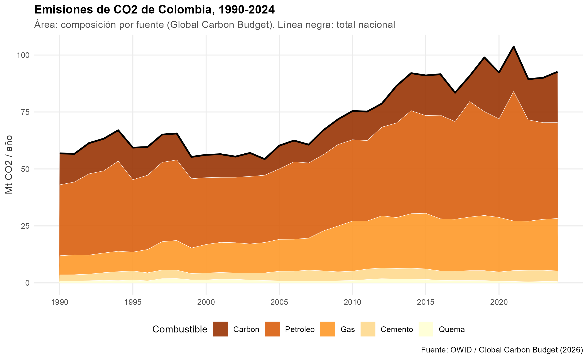{#fig-serie width="92%"}

La matriz eléctrica explica una fracción menor del problema y, al mismo tiempo, es la parte más limpia del sistema energético. En 2024 la generación fue de 83,3 TWh, de los cuales 54,5 TWh fueron hidroeléctricos (65 %), 24,4 TWh fósiles (29 %), 3,3 TWh solares y 0,9 TWh de biomasa. La participación de las FNCER no convencionales fue del 5,18 %, la más alta de la historia, y las emisiones evitadas por su operación se estiman en 1,29 Mt CO₂, apenas el 1,4 % del CO₂ nacional (Figura @fig-mix). Esa asimetría —una matriz limpia que produce pocas emisiones, dentro de un país cuyas emisiones están dominadas por transporte, industria y uso del suelo— es el hecho estructural que condiciona toda la discusión posterior.

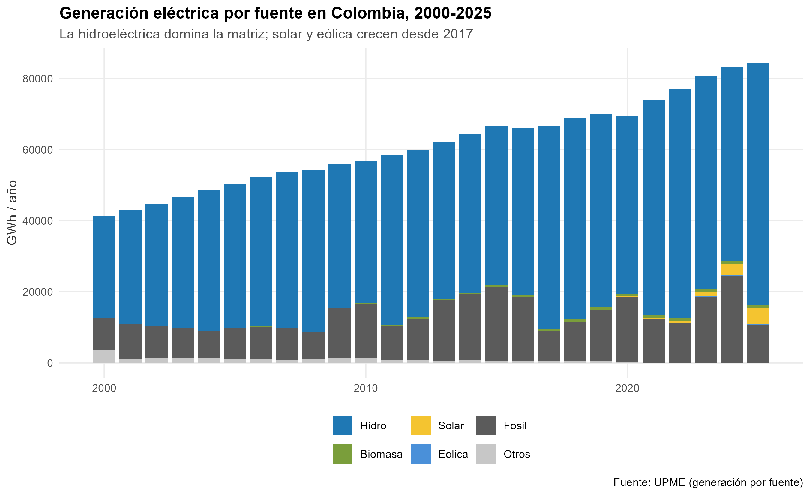{#fig-mix width="92%"}

La distribución espacial de las emisiones es extraordinariamente desigual. El 1 % de las celdas del marco (97 celdas) concentra el 63,9 % del CO₂ de 2023, el 5 % concentra el 80,9 % y el 10 % concentra el 88,4 %; el coeficiente de Gini de la distribución espacial es 0,927 y la mitad de las celdas, las menos emisoras, aporta apenas el 0,48 % del total (Figura @fig-lorenz). Esta concentración no es un detalle descriptivo: determina por completo el comportamiento de los estimadores muestrales y la utilidad de los mapas suavizados, como se muestra en las secciones siguientes.

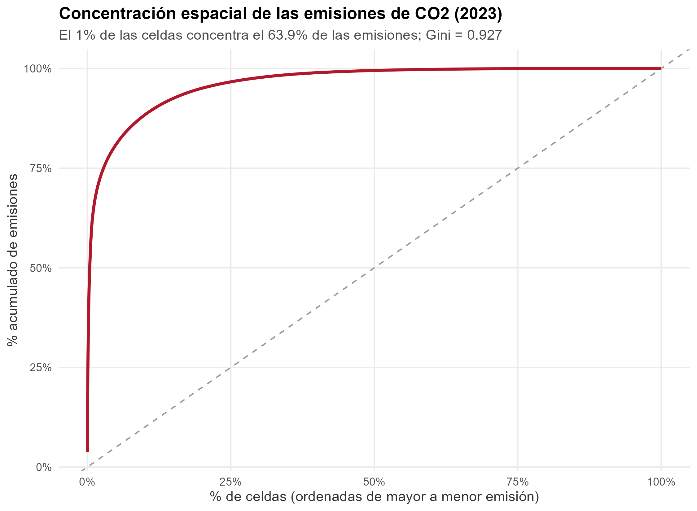{#fig-lorenz width="62%"}

Por regiones naturales, la Andina concentra el 51,6 % del CO₂ y el Caribe el 31,0 %, seguidas de la Pacífica (10,1 %), la Orinoquía (4,6 %) y la Amazonía (2,7 %). Entre 2015 y 2023 el Caribe fue la región que más creció (+29,0 %) y la Amazonía la que más aumentó en términos relativos (+35,2 %, aunque desde una base muy baja), mientras que la Andina y la Pacífica crecieron alrededor del 6 % (Tabla @tbl-regiones). El patrón es consistente con la expansión de la actividad portuaria, minera y de transporte en la costa Caribe y con la presión de la frontera agropecuaria en la Amazonía.

| Región | Celdas | Área (miles km²) | CO₂ 2015 (Mt) | CO₂ 2023 (Mt) | Participación 2023 (%) | Variación 2015-2023 (%) | Población (millones) |
|:-------|-------:|-----------------:|-------------:|-------------:|-----------------------:|------------------------:|---------------------:|
| Andina | 1.814 | 222,0 | 49,66 | 52,75 | 51,6 | +6,2 | 27,18 |
| Caribe | 1.157 | 140,3 | 24,55 | 31,67 | 31,0 | +29,0 | 11,64 |
| Pacífica | 1.143 | 140,8 | 9,72 | 10,34 | 10,1 | +6,3 | 8,26 |
| Orinoquía | 2.093 | 256,9 | 4,00 | 4,65 | 4,6 | +16,1 | 2,15 |
| Amazonía | 3.450 | 424,6 | 2,02 | 2,73 | 2,7 | +35,2 | 1,40 |

: Emisiones y población por región natural. Elaboración propia con EDGAR v2026 y WorldPop calibrado a OWID. {#tbl-regiones}

## Muestreo: cuánto CO₂ hay y con qué precisión se estima

El estudio Monte Carlo comparó cinco diseños para estimar el total de 102,14 Mt con muestras de 100 a 800 celdas de las 9.657 del marco. La Tabla @tbl-muestreo resume los resultados con $n = 400$. El muestreo aleatorio simple tiene un coeficiente de variación del 49,2 % y una cobertura del intervalo nominal del 72 %, es decir, falla en uno de cada cuatro casos. La estratificación por información auxiliar de 2015 con asignación proporcional apenas mejora (50,4 %), porque asigna la mayor parte de la muestra a estratos que aportan poco al total. La asignación de Neyman, en cambio, reduce el CV al 19,8 % y eleva la cobertura al 89,5 %: una ganancia de eficiencia de más de 600 veces en varianza frente al muestreo aleatorio simple. El muestreo espacialmente balanceado (GRTS) sin estratificar se comporta como el aleatorio simple en precisión (CV 44,8 %), pero aporta una mejor cobertura del territorio, y su combinación con la asignación de Neyman iguala el desempeño de esta última (CV 19,7 %).

| Diseño | n | Sesgo relativo (%) | CV (%) | RMSE relativo (%) | Cobertura IC 95 (%) | Eficiencia relativa |
|:-------|---:|-------------------:|-------:|------------------:|--------------------:|--------------------:|
| Muestreo aleatorio simple | 400 | −1,20 | 49,16 | 49,11 | 72,0 | 100,0 |
| Estratificado proporcional | 400 | +2,06 | 50,40 | 50,38 | 75,3 | 95,1 |
| Estratificado Neyman | 400 | +0,85 | 19,81 | 19,80 | 89,5 | 615,8 |
| GRTS | 400 | +0,87 | 44,76 | 44,32 | 78,0 | 120,6 |
| GRTS-Neyman | 400 | +0,87 | 19,69 | 19,51 | 88,0 | 623,4 |

: Comparación de diseños muestrales para el total de CO₂ de 2023 (400 réplicas Monte Carlo; 50 para los diseños GRTS). {#tbl-muestreo}

Dos resultados de esta tabla merecen comentario. Primero, todos los diseños son prácticamente insesgados —el sesgo relativo no supera el 2,1 %—, de modo que las diferencias son de precisión, no de validez. Segundo, incluso el mejor diseño tiene una cobertura inferior al 95 % nominal, lo que revela que la distribución del estimador es asimétrica y que los intervalos basados en la Normal son anticonservadores en poblaciones con colas tan pesadas.

El diagnóstico es inequívoco: para alcanzar un CV del 5 % con muestreo estratificado convencional se requerirían 7.537 celdas, el 78 % del marco. La razón es la concentración extrema descrita antes: el estrato superior (20 % de las celdas) aporta el 95 % de las emisiones y su desviación estándar interna (228.000 t por celda) es tres órdenes de magnitud mayor que la de los demás estratos. En estas condiciones, la solución estándar no es aumentar la muestra sino **censar las unidades dominantes**.

Se construyó entonces un diseño final con un **estrato de certeza**: las 194 celdas con emisión de 2015 superior a 42.039 t (el percentil 98) se incluyen con probabilidad uno, y las 206 restantes se asignan por Neyman y se seleccionan con GRTS dentro de cuatro estratos del resto. El estrato de certeza concentra el 67,1 % del CO₂ de 2023. La estimación resultante es de 97,45 Mt (error estándar 1,94; IC 95 %: 93,65-101,26) frente a un valor censal de 102,14 Mt, con un error relativo de −4,6 %; el estimador de razón que usa la emisión de 2015 como auxiliar produce 97,32 Mt (EE 0,57). El CV esperado del diseño es del 1,9 % (0,6 % con el estimador de razón), muy inferior al 19,8 % del diseño sin certeza (Figura @fig-muestreo).

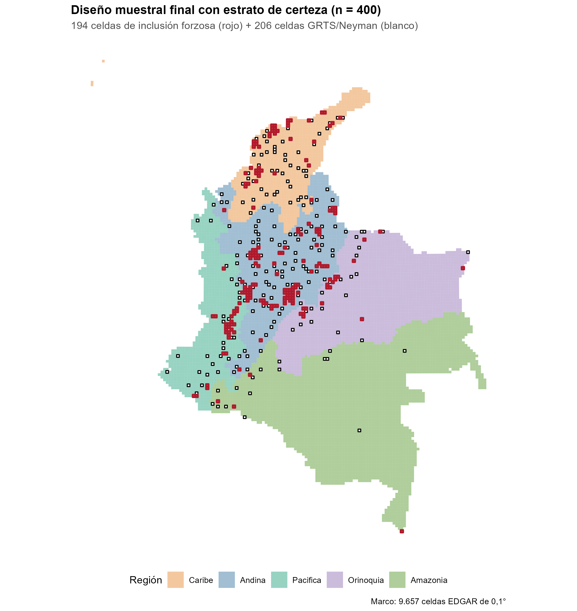{#fig-muestreo width="72%"}

El error observado del 4,6 % merece una advertencia metodológica. Aunque el CV analítico es del 1,9 %, la realización concreta quedó 4,6 % por debajo del censo, muy por encima de su error estándar estimado. La explicación es que la varianza calculada con la muestra subestima la cola de la distribución: en poblaciones con un Gini de 0,927, el error de muestreo depende de si se capturan o no unas pocas celdas gigantes, y esa probabilidad no se refleja bien en la varianza muestral. La lección práctica es que, para inventarios territoriales de emisiones, el estrato de certeza debe fijarse con un umbral más bajo (por ejemplo, el percentil 95) o complementarse con un registro censal de fuentes puntuales.

## Estadística espacial: dónde se concentran las emisiones

La densidad de emisiones presenta una autocorrelación espacial positiva y muy fuerte. El índice de Moran global es 0,785 con vecindad de reina a 16 km (p = 0,001 con 999 permutaciones), 0,815 con vecindad de torre a 12 km y 0,782 con seis vecinos más cercanos; la robustez a la definición de pesos descarta que el resultado dependa de una elección arbitraria de la matriz de contigüidad. El CO₂ total muestra un índice algo menor (0,749) y la población uno mayor (0,895), lo que sugiere que las emisiones siguen el poblamiento pero con una dispersión adicional asociada a la localización de actividades industriales y portuarias.

El análisis local identifica 2.154 celdas HH (22,3 % del total) y 3.122 celdas LL (32,3 %) significativas al 5 %, y la corrección de Benjamini-Hochberg deja 4.490 celdas significativas (46,5 %), lo que descarta que el patrón sea un artefacto de comparaciones múltiples. Los conglomerados de altas emisiones se concentran en la Andina (51,4 % de las celdas HH) y el Caribe (27,6 %), mientras que los de bajas emisiones se localizan en la Amazonía (78,0 % de las LL) y la Orinoquía (18,7 %). El mapa de la Figura @fig-lisa muestra una estructura núcleo-periferia nítida, con un corredor central de altas emisiones que va desde Antioquia y el eje cafetero hasta Bogotá y los puertos del Caribe.

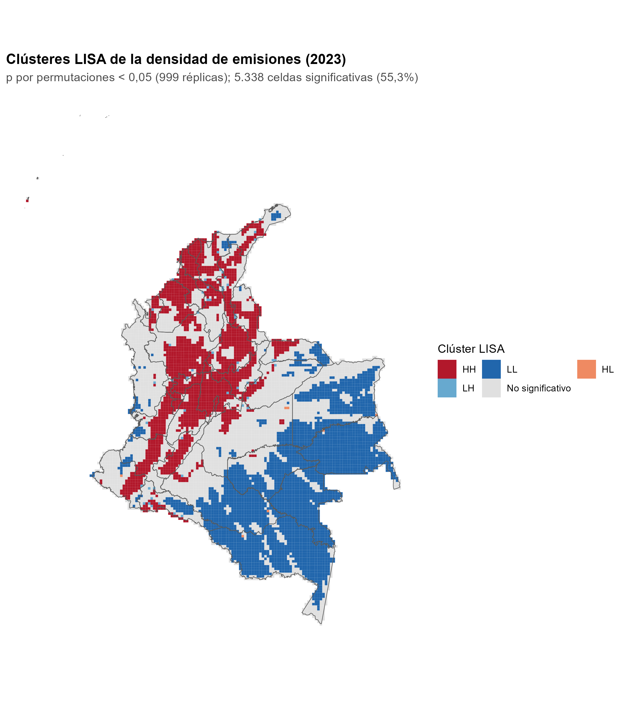{#fig-lisa width="66%"}

El semivariograma empírico se ajusta mejor a un modelo exponencial (SSE = 0,152) que a los modelos esférico (0,358) y gaussiano (0,544). Los parámetros son nugget 0,386, meseta 1,938 y rango práctico 167,6 km, con una proporción nugget/meseta de 0,199: el 80 % de la varianza de la densidad logarítmica es espacialmente estructurada y el 20 % restante es variabilidad de corto alcance (Figura @fig-variograma). El rango de 168 km implica que la influencia de una celda se extiende aproximadamente por dos departamentos, lo que tiene consecuencias directas para el diseño de políticas territoriales y para la validación de modelos.

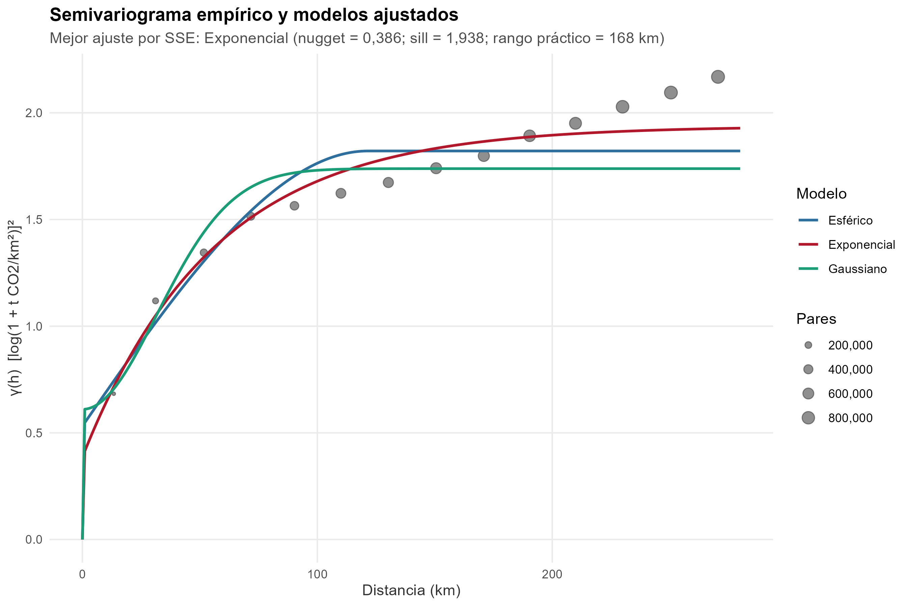{#fig-variograma width="78%"}

La comparación predictiva entre kriging ordinario e IDW arroja un resultado matizado. Con el conjunto completo de datos, el kriging es ligeramente mejor (RMSE 1,418 frente a 1,432 del mejor IDW, una mejora del 1,0 %), y la diferencia es significativa según la prueba de Diebold-Mariano con covarianza de largo plazo (DM = −2,19; p = 0,028) y según el bootstrap pareado (p < 0,001). Sin embargo, con el 25 % y el 50 % de los puntos de entrenamiento el kriging no supera al IDW (diferencias de +0,005 y +0,010, con p = 0,41 y p = 0,09), y el MAE de ambos métodos es prácticamente idéntico. La lectura correcta es que el kriging aporta una mejora marginal que se concentra en la cola de errores y que exige una densidad de datos suficiente para estimar el variograma; en un país con la cobertura de la red EDGAR, un método determinista bien calibrado es una alternativa razonable.

## Diseño de experimentos: qué tecnología y cuánta penetración

El experimento factorial de 240 corridas —cinco tecnologías, tres niveles de penetración y 16 bloques anuales— muestra que la tecnología es el factor dominante: $F(4,210) = 797{,}9$, $p < 0{,}001$, $\eta^2_p = 0{,}938$ (Tabla @tbl-anova). La penetración también es significativa ($F(2,210) = 64{,}3$; $p < 0{,}001$; $\eta^2_p = 0{,}380$), y la interacción tecnología × penetración explica una proporción muy alta de la varianza ($F(8,210) = 114{,}1$; $p < 0{,}001$; $\eta^2_p = 0{,}813$). El bloque anual es significativo pero moderado ($F(15,210) = 6{,}64$; $\eta^2_p = 0{,}322$), lo que confirma que la hidrología y la demanda introducen variabilidad relevante entre años.

| Fuente | gl | Suma de cuadrados | F | p | η² parcial |
|:-------|---:|------------------:|--:|--:|-----------:|
| Bloque (año) | 15 | 2,50 × 10¹⁴ | 6,64 | 1,3 × 10⁻¹¹ | 0,322 |
| Tecnología | 4 | 8,02 × 10¹⁵ | 797,89 | 1,0 × 10⁻¹²⁵ | 0,938 |
| Penetración | 2 | 3,23 × 10¹⁴ | 64,33 | 1,6 × 10⁻²² | 0,380 |
| Tecnología × Penetración | 8 | 2,29 × 10¹⁵ | 114,05 | 4,1 × 10⁻⁷² | 0,813 |
| Residuales | 210 | 5,28 × 10¹⁴ | — | — | — |

: ANOVA de tipo III del experimento factorial de emisiones evitadas (240 corridas). {#tbl-anova}

Las medias por tecnología permiten ordenar su efectividad (Tabla @tbl-tecnologias). La eólica evita 6,84 Mt CO₂ al año en promedio (677,7 t por GWh), seguida muy de cerca por la hidroeléctrica (6,70 Mt; 666,1 t/GWh) y por la solar (6,43 Mt; 642,3 t/GWh). La biomasa evita bastante menos (4,48 Mt; 473,6 t/GWh) porque su factor de emisión de combustión (0,216 t CO₂e/MWh) es una parte importante de lo que desplaza. El fósil, como era de esperar, incrementa las emisiones (−8,18 Mt; −708,0 t/GWh). La prueba de Tukey indica que eólica, hidro y solar no difieren estadísticamente entre sí (p = 0,71, 0,91 y 0,99), mientras que biomasa y fósil difieren de todas las demás (p < 0,001).

| Tecnología | Emisiones evitadas (t CO₂/año) | Mt CO₂/año | t CO₂/GWh (IC 95 %) |
|:-----------|------------------------------:|-----------:|--------------------:|
| Eólica | 6.837.757 | 6,84 | 677,7 (629,2-726,1) |
| Hidro | 6.703.873 | 6,70 | 666,1 (617,6-714,5) |
| Solar | 6.429.130 | 6,43 | 642,3 (593,8-690,7) |
| Biomasa | 4.481.374 | 4,48 | 473,6 (425,2-522,1) |
| Fósil | −8.184.223 | −8,18 | −708,0 (−711,0 a −705,0) |

: Emisiones evitadas por tecnología, promedio de 48 corridas (16 años × 3 penetraciones). {#tbl-tecnologias}

El efecto marginal de la penetración confirma la existencia de rendimientos decrecientes. En el modelo continuo, cada punto porcentual adicional de generación renovable evita 247.276 t CO₂ al año (EE 13.649; IC 95 %: 220.524-274.028), con un $R^2$ de 0,924. Por tecnología, la pendiente es de 290.760 t/pp para la eólica, 282.727 t/pp para la hidro, 266.242 t/pp para la solar y 149.377 t/pp para la biomasa, mientras que el fósil aporta −491.053 t/pp. El 37,5 % de las corridas (90 de 240) alcanza la saturación, es decir, el nivel de penetración supera la generación fósil disponible y el excedente ya no desplaza emisiones. Esa saturación es la que explica la interacción tan fuerte entre tecnología y penetración.

Las conclusiones del ANOVA se mantienen bajo tres especificaciones alternativas que relajan los supuestos. El ANOVA sobre la respuesta logarítmica conserva la tecnología como factor dominante ($F = 130{,}95$; $p = 6{,}7\times10^{-56}$; $\eta^2_p = 0{,}714$), la penetración ($F = 11{,}74$; $p = 1{,}5\times10^{-5}$) y la interacción ($F = 39{,}02$; $p = 1{,}3\times10^{-37}$). La prueba de Kruskal-Wallis rechaza la igualdad entre tecnologías ($\chi^2 = 127{,}12$; gl = 4; $p = 1{,}6\times10^{-26}$) y entre niveles de penetración ($\chi^2 = 55{,}13$; gl = 2; $p = 1{,}1\times10^{-12}$), y el ANOVA de Welch confirma el efecto de la tecnología ($F(4) = 81{,}85$; $p = 7{,}3\times10^{-33}$). La conclusión es robusta a la violación de Normalidad y homocedasticidad detectada en los residuales.

La Figura @fig-interaccion muestra el patrón que sintetiza el experimento: para las tres renovables principales las curvas son casi paralelas y crecientes, mientras que la biomasa crece más despacio y el fósil desciende en todo el rango. La separación entre tecnologías es mucho mayor que el efecto de la penetración, lo que sugiere que la composición de la expansión importa más que su volumen.

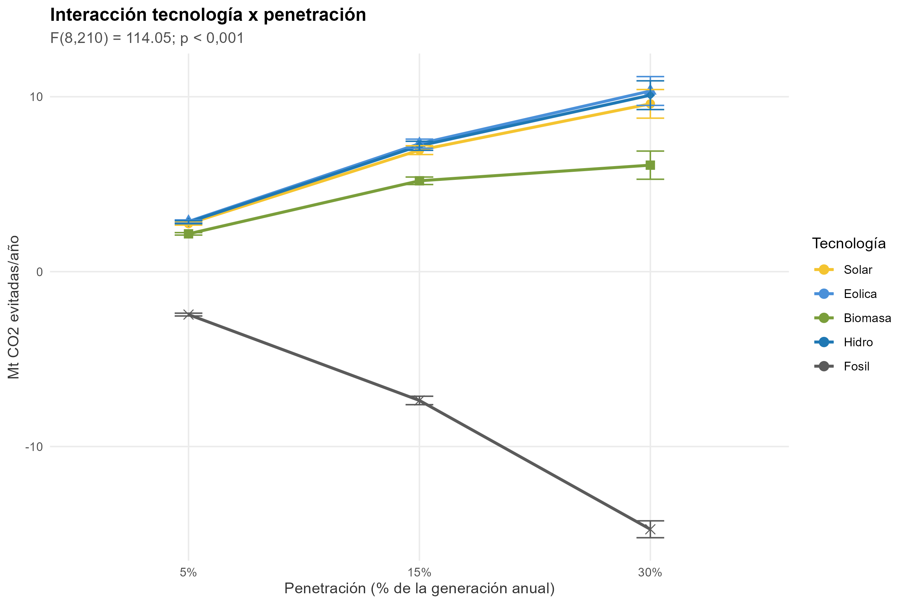{#fig-interaccion width="82%"}

### El límite estructural: superficie de respuesta para 2030

La superficie de respuesta para la mezcla solar-eólica de 2030 revela una restricción que el análisis factorial insinúa pero no cuantifica. Con una composición climáticamente neutra (participación media 2015-2025: hidro 77,4 %, biomasa 1,0 %, otros 0,5 % y fósil 21,1 %), las emisiones del sector eléctrico en 2030 serían de 16,36 Mt CO₂ sin FNCER adicional, de las cuales 14,39 Mt provienen del fósil y 1,97 Mt del ciclo de vida de la hidroeléctrica y la biomasa (Figura @fig-rsm).

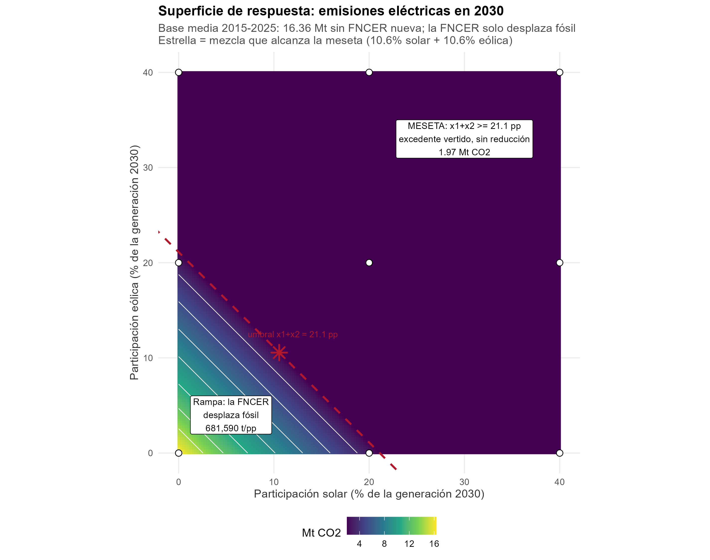{#fig-rsm width="74%"}

Como la FNCER adicional solo puede desplazar generación fósil, el potencial de reducción está acotado por la participación fósil. El umbral de "FNCER útil" es de 21,1 puntos porcentuales de la generación: una vez alcanzado, el excedente se vierte y no produce ninguna reducción adicional. La reducción máxima alcanzable es de 14,39 Mt CO₂ (−87,9 % de la base), lo que dejaría al sector eléctrico en 1,97 Mt, correspondientes al ciclo de vida de las renovables. En la región no saturada la reducción marginal es de 681.590 t CO₂ por punto porcentual, con tramos diferenciados por el orden de mérito: 836.080 t/pp mientras se desplaza carbón (0-5,6 pp), 615.472 t/pp en el tramo de gas (5,6-18,3 pp) y 672.006 t/pp cuando se desplazan líquidos (18,3-21,1 pp).

La implicación es contundente. Incluso en el escenario más favorable —solar y eólica cubriendo el 21,1 % de la generación, con una mezcla de 10,6 % y 10,6 % que alcanza la meseta— la reducción máxima del sector eléctrico es de 14,4 Mt CO₂. Eso equivale al 15,5 % del CO₂ nacional de 2024 y al 5,8 % de los GEI totales. La sensibilidad con la base de 2025 (año húmedo) confirma el patrón: la base baja a 11,31 Mt, el umbral a 13,4 pp y la reducción máxima a 9,12 Mt (−80,6 %), con conclusiones cualitativas idénticas. Más allá del umbral, la FNCER no reduce emisiones: en la esquina del diseño (40 % + 40 %) se vertería el 58,9 % de la demanda.

## Aprendizaje automático: qué explica la densidad y qué cabe esperar en 2030

### Determinantes de la densidad de emisiones

El modelo espacial de celdas identifica la densidad poblacional y la población total como los predictores dominantes: la importancia por permutación de la densidad poblacional es de 2,25 puntos de MSE (100 % relativo) y la de la población total de 1,99 (88,5 %), seguidas por la longitud (56,6 %), el área de la celda (22,9 %) y la latitud (20,6 %) (Figura @fig-importancia). La distancia al municipio con FNCER más cercano y el número de proyectos tienen una importancia marginal, lo que es coherente con la escala del despliegue: 4.515 MW declarados difícilmente alteran el patrón de emisiones de una celda de 11 km.

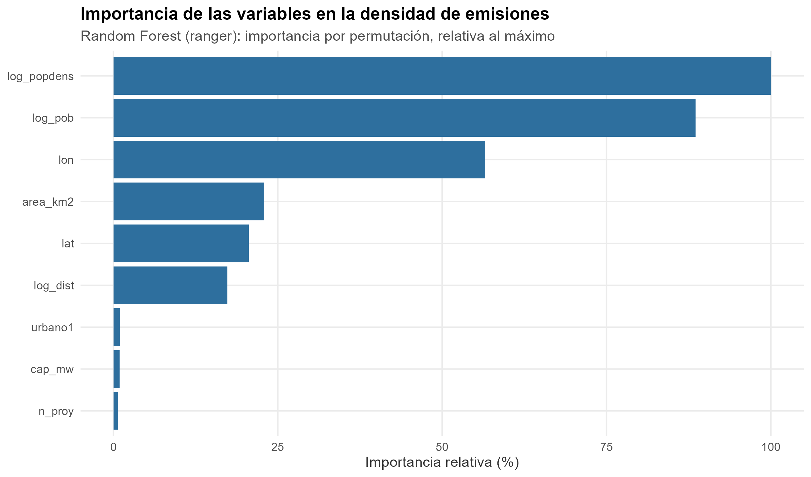{#fig-importancia width="76%"}

La capacidad predictiva es moderada y similar entre modelos: la regresión lineal alcanza un $R^2$ de 0,411, el Random Forest de 0,383 y XGBoost de 0,257 en validación espacial por bloques. El hecho de que una especificación lineal iguale o supere a los modelos de árboles indica que la relación entre las covariables disponibles y la densidad de emisiones es esencialmente log-lineal; el valor del aprendizaje automático en este problema no está en la forma funcional sino en la capacidad de detectar interacciones y umbrales, que aquí resultan secundarios frente al gradiente urbano-rural.

El resultado metodológicamente más relevante es la diferencia entre esquemas de validación. El mismo Random Forest obtiene un RMSE de 0,713 con validación cruzada aleatoria y de 0,889 con validación espacial por bloques, un optimismo del 24,7 % (Figura @fig-cvesp). Validar sin respetar la estructura espacial conduce a una conclusión demasiado optimista sobre la capacidad predictiva del modelo, un sesgo documentado en la literatura y que aquí se cuantifica en un cuarto del error.

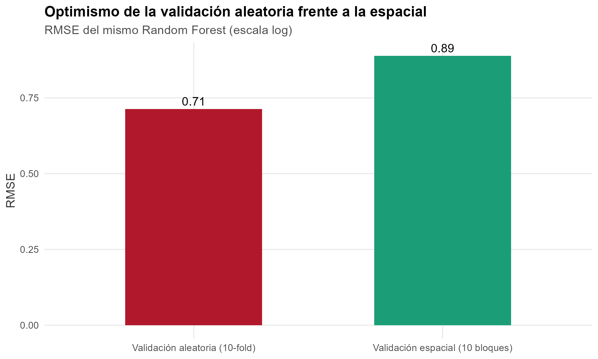{#fig-cvesp width="62%"}

Los residuales del modelo conservan autocorrelación espacial significativa (I de Moran = 0,179; p < 0,001), aunque muy inferior a la de la variable original (0,785). El modelo captura, por tanto, la mayor parte de la estructura espacial —asociada al gradiente poblacional— pero deja sin explicar un componente ligado a la localización de actividades específicas que las covariables disponibles no representan.

### Pronóstico a 2030 y evaluación de la meta

La serie de crecimiento anual del CO₂ es difícil de predecir. En la validación de origen móvil, ningún modelo supera al pronóstico ingenuo (media histórica de la tasa de crecimiento), que obtiene un RMSE de 8,74 puntos porcentuales; el Random Forest alcanza 9,86, la regresión 9,71, XGBoost 10,81 y la combinación de los cuatro 9,64 (Tabla @tbl-cvml). Todos los $R^2$ son negativos, lo que significa que las covariables macroeconómicas y la hidrología no permiten anticipar la tasa de crecimiento anual mejor que su promedio histórico. Este resultado, lejos de ser un fracaso del aprendizaje automático, es un hallazgo sustantivo: la trayectoria anual del CO₂ colombiano está dominada por shocks de hidrología y de actividad económica que no son predecibles con la información disponible.

| Modelo | RMSE (p.p.) | MAE (p.p.) | R² | Sesgo (p.p.) |
|:-------|------------:|-----------:|---:|-------------:|
| Ingenuo (media histórica) | 8,74 | 7,14 | −0,182 | +2,80 |
| Regresión lineal | 9,71 | 8,28 | −0,458 | +3,79 |
| Random Forest | 9,86 | 8,42 | −0,505 | +2,27 |
| XGBoost | 10,81 | 9,51 | −0,806 | +2,48 |
| Combinación (media de los cuatro) | 9,64 | 8,14 | −0,437 | +2,84 |

: Validación de origen móvil del pronóstico de la tasa de crecimiento del CO₂ (2015-2024). {#tbl-cvml}

Por esa razón, la trayectoria central se ancla en el promedio histórico de crecimiento (2,2 % anual) y su incertidumbre se propaga con la desviación observada en la validación. Los escenarios comparten las mismas hipótesis macroeconómicas (PIB 3,0 % anual, población 0,9 % anual, hidrología media de 76 %) y difieren solo en la penetración de FNCER en 2030. Los resultados se presentan en la Tabla @tbl-escenarios y en la Figura @fig-pronostico.

| Escenario | FNCER 2030 (%) | CO₂ 2030 (Mt, mediana) | IC 95 % | Reducción vs BAU (%) | P(CO₂ 2030 < 2024) | P(CO₂ 2030 < 2015) |
|:----------|---------------:|-----------------------:|--------:|---------------------:|-------------------:|-------------------:|
| BAU | 8 | 106,4 | 70,1-165,9 | — | 0,27 | 0,25 |
| Moderado | 20 | 98,3 | 63,0-154,1 | 7,6 | 0,39 | 0,36 |
| Acelerado | 35 | 90,1 | 52,3-149,0 | 15,2 | 0,54 | 0,51 |

: Escenarios de CO₂ a 2030 (2.000 simulaciones por escenario). {#tbl-escenarios}

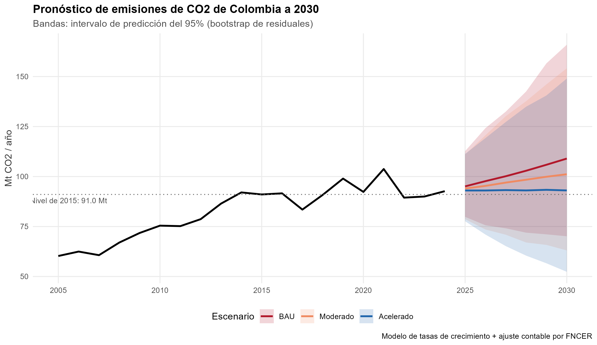{#fig-pronostico width="88%"}

Tres lecturas se desprenden de estos resultados. Primera, la incertidumbre es enorme: el intervalo del 95 % del escenario BAU va de 70 a 166 Mt, un rango que refleja tanto la volatilidad histórica de la tasa de crecimiento como la incertidumbre sobre la trayectoria macroeconómica. Segunda, el efecto de la política es real pero acotado: pasar de 8 % a 35 % de FNCER reduce el CO₂ de 2030 en 16,2 Mt (15,2 %), muy por debajo de lo que sugiere la comparación ingenua de factores de emisión. Tercera, la probabilidad de que el CO₂ de 2030 sea inferior al de 2024 es de 0,27 en el escenario BAU, 0,39 en el moderado y 0,54 en el acelerado; solo en este último la reducción es más probable que su ausencia.

El contraste con la Ley 2169 es el resultado central del trabajo (Tabla @tbl-ley). El techo legal de 169,44 Mt CO₂e se refiere a GEI totales. Si las emisiones no-CO₂ (incluido el uso del suelo) se mantuvieran en su nivel de 2024 —155,62 Mt CO₂e—, el CO₂ compatible con el techo sería de apenas 13,82 Mt, una cifra que ni siquiera el escenario más agresivo de FNCER permite alcanzar. En el escenario BAU, los GEI de 2030 ascenderían a 262,0 Mt CO₂e, con una brecha de 92,5 Mt frente al techo legal; incluso en el escenario acelerado, la brecha sería de 76,4 Mt.

| Concepto | Mt CO₂e |
|:---------|--------:|
| CO₂ 2030, escenario BAU | 106,36 |
| CO₂ 2030, escenario moderado | 98,31 |
| CO₂ 2030, escenario acelerado | 90,15 |
| Emisiones no-CO₂ + uso del suelo (2024) | 155,62 |
| GEI 2030 implícitos, escenario BAU | 261,98 |
| Techo legal 2030 (Ley 2169, art. 5) | 169,44 |
| Brecha frente al techo legal (BAU) | 92,54 |
| CO₂ compatible con el techo si el no-CO₂ no cambia | 13,82 |

: Contraste del pronóstico con la meta de la Ley 2169 de 2021. {#tbl-ley}

La Figura @fig-probabilidades resume la evidencia probabilística. Incluso en el escenario acelerado, la probabilidad de que el CO₂ de 2030 quede por debajo del nivel de 2015 es apenas 0,51, es decir, una moneda al aire. La conclusión no es que la política sea irrelevante, sino que su alcance está estructuralmente limitado por el tamaño del sector eléctrico dentro del inventario nacional.

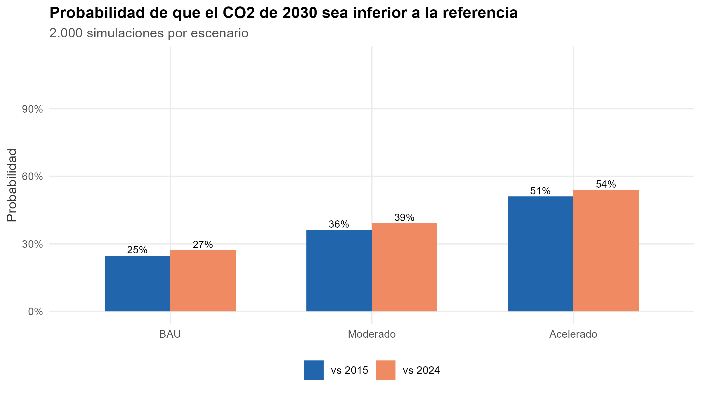{#fig-probabilidades width="68%"}

# Discusión

## Lo que los cuatro módulos dicen en conjunto

Los cuatro módulos responden preguntas distintas y sus resultados se complementan sin contradicciones. El muestreo establece que el total nacional puede estimarse con precisión aceptable solo si se censan las fuentes dominantes: la concentración espacial (Gini 0,927) es el hecho que organiza todo lo demás. La estadística espacial muestra que esa concentración tiene estructura —un gradiente núcleo-periferia con dependencia hasta 168 km— y que los modelos aspatiales dejan sin explicar una parte de ella. El diseño de experimentos cuantifica el efecto de cada tecnología y revela el límite estructural del 21,1 % de participación fósil. El aprendizaje automático confirma que la densidad de emisiones está gobernada por el poblamiento y que la trayectoria anual es esencialmente impredecible con las covariables disponibles.

La integración produce un mensaje que ninguno de los módulos podría sostener por separado: **Colombia puede reducir sus emisiones de CO₂ con FNCER, pero no puede cumplir la meta del 51 % con ellas**. La razón es aritmética antes que política. El sector eléctrico emite alrededor de 16-26 Mt CO₂ al año, entre el 17 % y el 28 % del CO₂ nacional según el alcance del inventario; incluso llevándolo a cero, la reducción no alcanzaría los 14,4 Mt que fija el límite estructural, y el techo legal exige reducir más de 90 Mt CO₂e adicionales respecto del escenario de referencia.

## Comparación con la literatura

Los resultados son consistentes con los estudios que han señalado el limitado potencial de mitigación del sector eléctrico colombiano dada su composición hidroeléctrica (Gaona et al., 2015; Henao et al., 2020). Aportan, sin embargo, tres elementos que la literatura nacional suele tratar por separado. Primero, la cuantificación del umbral de saturación —21,1 puntos porcentuales— como una restricción derivada de la estructura de la matriz y no de un supuesto de política. Segundo, la evidencia de que las tecnologías renovables no son equivalentes: la biomasa evita un 30 % menos por GWh que la eólica, lo que tiene consecuencias para la priorización de la cartera. Tercero, la constatación de que la validación espacial reduce en un cuarto la capacidad predictiva aparente de los modelos de emisiones, un sesgo que afecta a buena parte de la literatura aplicada que valida con particiones aleatorias (Roberts et al., 2017; Meyer & Pebesma, 2021).

La comparación con las estimaciones oficiales de emisiones evitadas es ilustrativa. El cálculo propio con la generación de la UPME y la intensidad de Ember arroja 1,29 Mt CO₂ evitadas por la operación FNCER en 2024, aplicando la intensidad del sistema (0,30 t CO₂e/MWh) a los 4,3 TWh renovables no convencionales. Esa cifra es la que suele reportarse como beneficio de la operación, pero subestima el efecto de la expansión futura. El experimento factorial muestra, no obstante, que el factor de emisión relevante para la expansión futura es el marginal (0,55 t CO₂/MWh), no el promedio, porque la nueva generación desplaza las plantas fósiles que operan en el margen y no una mezcla proporcional de toda la matriz. Usar el factor promedio subestima el efecto de la FNCER en un 45 %, mientras que suponer que desplaza solo carbón lo sobreestima.

## Implicaciones de política

Tres implicaciones se derivan de los resultados. La primera es que la prioridad del sector eléctrico no es la reducción de emisiones sino la seguridad del suministro y la competitividad: con una matriz ya descarbonizada, cada MWh renovable adicional reduce emisiones solo mientras quede fósil por desplazar, y ese margen se agota en 21 puntos porcentuales. La segunda es que la meta del 51 % depende de manera abrumadora de la deforestación, el transporte y la industria: el uso del suelo aporta el 27,4 % de los GEI y el transporte es el mayor componente del CO₂ fósil. Sin una reducción drástica de la deforestación —la Ley 2169 fija cero hectáreas netas a 2030— el techo de 169,44 Mt es inalcanzable aunque el sector eléctrico se descarbonice por completo. La tercera es que la evaluación de la política requiere instrumentos de medición adecuados: la concentración extrema de las emisiones implica que los sistemas de monitoreo deben combinar un registro censal de fuentes puntuales con un muestreo probabilístico del territorio para las fuentes difusas.

## Limitaciones

El estudio tiene limitaciones que conviene explicitar. La más importante es que el experimento factorial y la superficie de respuesta son ejercicios de contabilidad técnica, no modelos de equilibrio general ni planes de expansión con restricciones de costo, red o almacenamiento. El umbral de 21,1 pp es una cota inferior del potencial —con baterías o interconexiones se elevaría— y la reducción máxima de 14,4 Mt es una cota superior de la contribución del sector eléctrico en 2030.

La segunda limitación es la incertidumbre del pronóstico. Con 23 observaciones anuales y dos regímenes de crecimiento, la trayectoria a 2030 no puede estimarse con precisión: los distintos modelos producen valores entre 81 y 121 Mt para el escenario BAU, y el intervalo de predicción del 95 % abarca de 70 a 166 Mt. El valor central de 106,4 Mt debe interpretarse como una referencia condicional a las hipótesis macroeconómicas, no como una predicción puntual.

La tercera es la calidad de los datos de emisiones. EDGAR y Climate TRACE difieren en su cobertura —el primero reporta CO₂ fósil, el segundo incluye uso del suelo— y su correlación a escala de celda es moderada (r = 0,43 en la comparación de combustión). El análisis espacial y el modelo de celdas dependen de la calidad de EDGAR, mientras que el pronóstico nacional depende del Global Carbon Budget y del inventario nacional. La triangulación entre fuentes es, por tanto, una necesidad metodológica y no un lujo.

La cuarta es que el análisis causal se limita al experimento computacional. El panel municipal construido (1.008 municipios, 65 tratados) permitiría en el futuro un diseño cuasi-experimental con emparejamiento por puntuación de propensión, pero la ventana 2015-2023 es demasiado corta y la capacidad instalada demasiado pequeña para detectar efectos con potencia estadística adecuada.

# Conclusiones

Este trabajo integró muestreo, estadística espacial, diseño de experimentos y aprendizaje automático para responder si Colombia puede reducir sus emisiones de CO₂ para 2030 en el marco de la Ley 2169 de 2021. Las conclusiones principales son las siguientes.

1. **Las emisiones están extremadamente concentradas y espacialmente estructuradas.** El 1 % de las celdas concentra el 63,9 % del CO₂, el índice de Moran es 0,785 y el rango de dependencia espacial es de 168 km. Esta estructura condiciona tanto el diseño de los sistemas de medición como la focalización de la política.

2. **La estimación del total nacional exige censar las fuentes dominantes.** El muestreo aleatorio simple con 400 celdas tiene un CV del 49 %; la asignación de Neyman lo reduce al 20 %; un estrato de certeza del 2 % de las celdas lo reduce al 2 %. Para un inventario operativo, el diseño recomendado combina un censo de fuentes puntuales con un muestreo probabilístico del territorio.

3. **Las tecnologías renovables no son equivalentes.** La eólica (677,7 t CO₂/GWh), la hidroeléctrica (666,1) y la solar (642,3) evitan emisiones similares y estadísticamente indistinguibles; la biomasa evita un 30 % menos (473,6) y el fósil incrementa las emisiones (−708,0). El efecto de la tecnología es mucho mayor que el de la penetración ($\eta^2_p$ de 0,938 frente a 0,380).

4. **Existe un límite estructural de 21,1 puntos porcentuales.** Como casi el 79 % de la electricidad ya es renovable, la FNCER adicional solo puede desplazar la fracción fósil. La reducción máxima del sector eléctrico es de 14,4 Mt CO₂, equivalente al 15,5 % del CO₂ nacional y al 5,8 % de los GEI totales. Más allá de ese umbral, la FNCER adicional no reduce emisiones.

5. **El CO₂ de 2030 probablemente se mantendrá cerca de los niveles actuales.** El escenario BAU proyecta 106,4 Mt (IC 95 %: 70-166), el moderado 98,3 Mt y el acelerado 90,1 Mt. La probabilidad de que el CO₂ de 2030 sea inferior al de 2024 es de 0,27, 0,39 y 0,54 respectivamente; la de quedar por debajo de 2015 es de 0,25, 0,36 y 0,51.

6. **La meta del 51 % no se cumple con FNCER.** Con el nivel de emisiones no-CO₂ de 2024, el CO₂ compatible con el techo de 169,44 Mt CO₂e sería de 13,82 Mt, y los GEI de 2030 en el escenario BAU llegarían a 262,0 Mt, con una brecha de 92,5 Mt. La meta depende de la deforestación, el transporte y la industria, no de la matriz eléctrica.

La respuesta a la pregunta que dio origen al estudio es, por tanto, matizada: **Colombia sí puede reducir sus emisiones de CO₂ con energías no convencionales, pero el alcance de esa reducción está estructuralmente acotado y es insuficiente para cumplir la meta legal**. La transición energética es una condición necesaria pero no suficiente de la acción climática colombiana; sin una política de uso del suelo y de transporte a la altura del compromiso, el techo de 2030 seguirá siendo inalcanzable.

# Trabajo futuro

Tres extensiones se derivan directamente de este trabajo. La primera es incorporar restricciones de costo, red y almacenamiento al modelo de despacho, de modo que el umbral de 21,1 pp se convierta en un rango dependiente de la flexibilidad del sistema. La segunda es explotar el panel municipal para un diseño cuasi-experimental con emparejamiento por puntuación de propensión y variables instrumentales, que permita estimar el efecto observado del despliegue FNCER en los municipios tratados. La tercera es ampliar el marco de datos con variables de uso del suelo y de transporte —las dos fuentes dominantes de emisiones— para que el pronóstico cubra los GEI totales y no solo el CO₂ fósil.

# Referencias

Anselin, L. (1995). Local indicators of spatial association—LISA. *Geographical Analysis*, 27(2), 93-115.

Arango-Aramburo, S., et al. (2019). Climate impacts on the Colombian electricity system. *Energy Policy*, 132, 1-12.

Box, G. E. P., & Wilson, K. B. (1951). On the experimental attainment of optimum conditions. *Journal of the Royal Statistical Society B*, 13(1), 1-45.

Breiman, L. (2001). Random forests. *Machine Learning*, 45(1), 5-32.

Chen, T., & Guestrin, C. (2016). XGBoost: A scalable tree boosting system. *Proceedings of the 22nd ACM SIGKDD*, 785-794.

Congreso de la República de Colombia. (2021). *Ley 2169 de 2021, por medio de la cual se impulsa el desarrollo bajo en carbono del país*. Diario Oficial 51.896. http://secretariasenado.gov.co/senado/basedoc/ley_2169_2021.html

Crippa, M., et al. (2023). *EDGAR v8.1 global greenhouse gas emissions*. European Commission, Joint Research Centre. https://edgar.jrc.ec.europa.eu

Ember. (2026). *Yearly electricity data: Colombia*. https://ember-energy.org/data/yearly-electricity-data/

Friedlingstein, P., et al. (2023). Global carbon budget 2023. *Earth System Science Data*, 15, 5301-5369.

Gaona, E., et al. (2015). Potencial de las fuentes no convencionales de energía renovable en Colombia. *Revista de Ingeniería*, 42, 20-28.

Henao, F., et al. (2020). Renewable energy integration in Colombia: Emissions and costs. *Renewable Energy*, 146, 1-14.

Horvitz, D. G., & Thompson, D. J. (1952). A generalization of sampling without replacement from a finite universe. *Journal of the American Statistical Association*, 47(260), 663-685.

IDEAM, MinAmbiente, DNP, Cancillería, PNUD & Fundación Natura. (2026). *Cuarta Comunicación Nacional de Cambio Climático y Segundo Informe Bienal de Transparencia (BTR2)*. https://unfccc.int/documents/660026

Meyer, H., & Pebesma, E. (2021). Predicting into unknown space? Estimating the area of applicability of spatial prediction models. *Methods in Ecology and Evolution*, 12(9), 1620-1633.

MinAmbiente. (2020). *Actualización de la Contribución Determinada a Nivel Nacional de Colombia (NDC)*. https://www.minambiente.gov.co/wp-content/uploads/2021/10/informe-actualizacion-contribucion-determinada-Colombia-ndc-2020.pdf

Ministerio de Minas y Energía. (2026, 27 de enero). *Colombia acelera la transición energética: las energías limpias ya representan el 15,6 % de la matriz eléctrica*. https://www.minenergia.gov.co

Moran, P. A. P. (1950). Notes on continuous stochastic phenomena. *Biometrika*, 37(1/2), 17-23.

Neyman, J. (1934). On the two different aspects of the representative method. *Journal of the Royal Statistical Society*, 97(4), 558-625.

República de Colombia. (2025). *Contribución Determinada a Nivel Nacional (NDC 3.0): Transformaciones para la Vida*. https://unfccc.int/sites/default/files/2025-12/NDC%203.0%20Transformaciones%20para%20la%20Vida%20%28Colombia%29.pdf

Roberts, D. R., et al. (2017). Cross-validation strategies for data with temporal, spatial, hierarchical, or phylogenetic structure. *Ecography*, 40(8), 913-929.

Stevens, D. L., & Olsen, A. R. (2004). Spatially balanced sampling of natural resources. *Journal of the American Statistical Association*, 99(465), 262-278.

UPME. (2025). *Estrategia 6GW: enfoque territorial*. https://docs.upme.gov.co/Documents/Enfoque-territorial/Territorial_6GW.pdf

XM. (2026). *En 2025 se declararon en operación comercial 40 proyectos de transmisión y 75 de generación*. https://www.xm.com.co

# Apéndice A. Reproducibilidad

Todo el análisis se reproduce ejecutando los scripts en orden desde la raíz del proyecto:

| Script | Contenido | Salidas principales |
|:-------|:----------|:--------------------|
| `00_setup.R` | Rutas, paquetes, paletas, funciones | — |
| `01_preproc.R` | Marco muestral, panel nacional, panel municipal | `datos/procesados/*.rds` |
| `01b_eda.R` | Análisis exploratorio y figuras descriptivas | `output/figures/eda_*` |
| `02_sampling.R` | Comparación Monte Carlo de diseños | `02_muestreo_*` |
| `02b_diseno_final.R` | Diseño con estrato de certeza | `02b_muestreo_*` |
| `03_spatial.R` | Moran, LISA, variograma, kriging | `03_*` |
| `04_doe.R` | Factorial, ANOVA, superficie de respuesta | `04_*` |
| `05_ml.R` | Modelos de celdas y pronóstico | `05_*` |
| `06_resumen.R` | Consolidación de resultados | `06_resumen_global.csv` |

Los datos de entrada se documentan en `docs/ESQUEMA_DATOS.md` y las fuentes externas en `docs/FUENTES_CO2_ESPACIAL.md`. La semilla global es 2026.

# Apéndice B. Glosario

- **FNCER**: fuentes no convencionales de energía renovable (solar, eólica, biomasa, pequeñas hidroeléctricas).
- **GEI**: gases de efecto invernadero, expresados en CO₂ equivalente.
- **GRTS**: muestreo estratificado por teselación aleatoria generalizada, espacialmente balanceado.
- **HT**: estimador de Horvitz-Thompson.
- **LISA**: indicadores locales de asociación espacial.
- **Neyman**: asignación óptima de la muestra proporcional a $N_h S_h$.
- **PSM**: emparejamiento por puntuación de propensión.
- **Techo legal**: 169,44 Mt CO₂e en 2030, derivado de la Ley 2169 y de la NDC.

